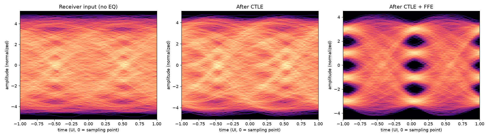
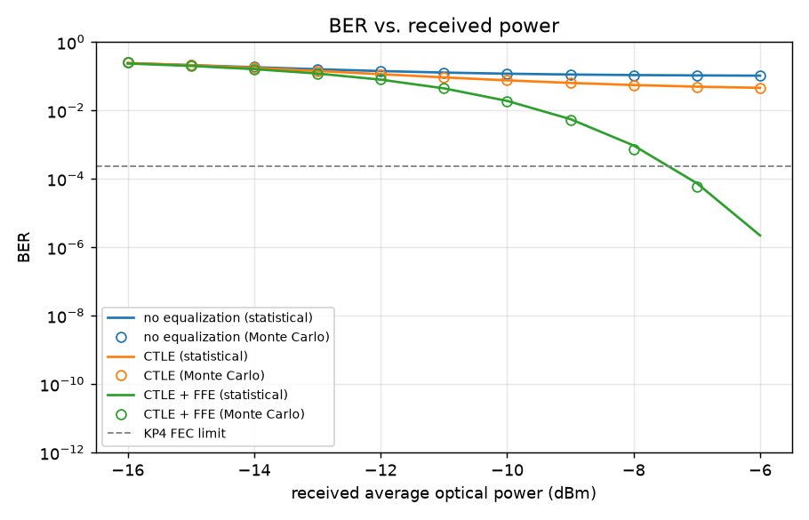
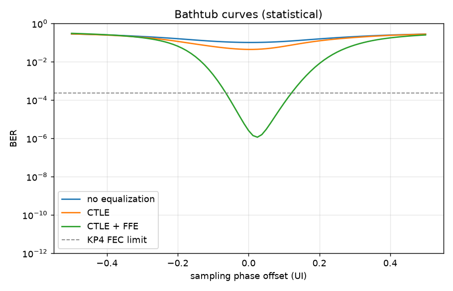
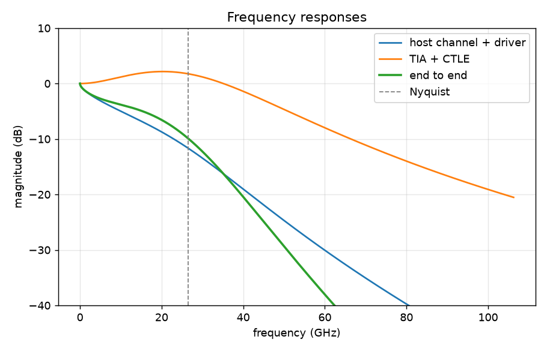
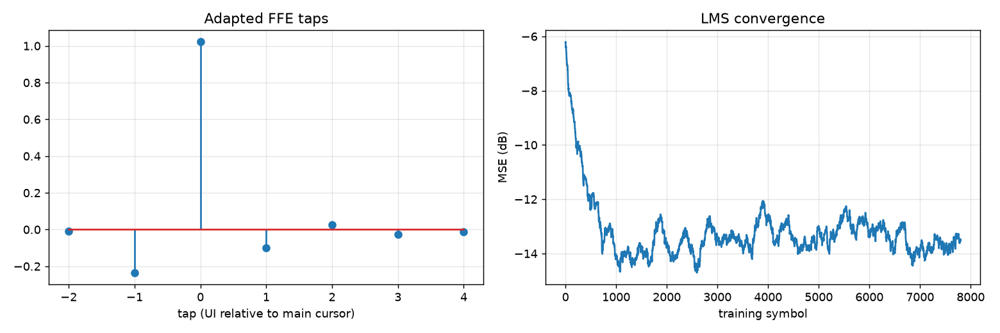

# pam4-link-model

End-to-end Python behavioral model of a **106.25 Gb/s PAM4 electro-optical link**, the kind of
single-lane optical datapath used in 400G/800G optics and co-packaged optics. It models the
transmitter, optics, receiver, equalization and clock jitter, and reports eye diagrams, bathtub curves
and BER vs. received optical power.

## Signal chain

```
PRBS31 ─► PAM4 Gray map ─► DAC ─► host channel loss ─► modulator driver ─► optical modulator
          (53.125 GBd)              (skin + dielectric)   (BW limit + tanh      (extinction ratio)
                                                          compression)                │
                                                                                      ▼
  BER ◄─ slicer ◄─ LMS FFE ◄─ jittered sampling ◄─ CTLE ◄─ TIA (BW) ◄─ + noise ◄─ photodiode ◄─ fiber loss
                   (7 taps)   (RJ + SJ, ideal CDR)                     (input-referred A/√Hz)
```

| Block | Model |
|---|---|
| PRBS | Fibonacci LFSR, PRBS7/9/11/13/15/23/31 (ITU-T O.150 / IEEE 802.3 polynomials) |
| PAM4 | Gray-coded levels {−3, −1, +1, +3} |
| Host channel | Insertion loss ∝ mix of √f (skin) and f (dielectric), set by loss at Nyquist |
| Driver | 2nd-order Butterworth bandwidth + tanh compression |
| Modulator | Optical power `P = Pavg (1 + m·v)`, `m` from extinction ratio |
| Photodiode + TIA | Responsivity, input-referred white noise current, 2nd-order bandwidth |
| CTLE | One zero / two poles, unity DC gain, configurable peaking |
| Clock | Random jitter (Gaussian) + sinusoidal jitter, phase from an ideal CDR |
| FFE | Symbol-spaced, normalized-LMS adaptation on training symbols |
| BER | Monte Carlo bit-error count **and** statistical BER (noiseless samples + Gaussian noise σ) |

All blocks after the noise source are linear, so the simulator carries the signal and the noise
separately. One run therefore gives both an error count and a statistical BER that reaches far below
what Monte Carlo can resolve (used for the bathtub curves and sensitivity).

## Usage

```bash
python3 -m venv .venv && . .venv/bin/activate
pip install -r requirements.txt

python scripts/run_demo.py          # full run, writes plots/ and plots/metrics.json
python scripts/run_demo.py --quick  # faster, fewer symbols
pytest -q                           # regression suite
```

```python
from dataclasses import replace
from pam4link import LinkConfig, simulate

res = simulate(replace(LinkConfig(), fiber_loss_db=12, ctle_peaking_db=6))
print(res.ber, res.ber_statistical, res.eye_opening())
```

## Tests

- **Blocks:** PRBS maximal length, Gray mapping, slicer, Q-function inverse, Butterworth −3 dB point,
  CTLE peaking, channel loss at Nyquist, LMS recovering a known ISI channel.
- **Theory check:** on a distortion-free link, simulated BER matches the analytical Gaussian-noise
  PAM4 BER `0.75·Q(d/2σ)` within 0.5 dB across several received powers and seeds.
- **Self-consistency:** statistical BER matches Monte Carlo BER within 0.5 dB on the fully impaired link.
- **Behavior:** CTLE and FFE each widen the eye on a lossy channel; BER drops as received power rises;
  the bathtub minimum is at the sampling point.

## Results

Default link: 106.25 Gb/s PAM4, 10 dB host-channel loss at Nyquist, 32 GHz driver, 5 dB extinction
ratio, 35 GHz TIA with 15 pA/√Hz input noise, 0.01 UI RJ + 0.05 UI SJ, −6 dBm average received power.
Numbers below are from `python scripts/run_demo.py` (`plots/metrics.json`).

| Receiver | Vertical eye opening | Eye width @ KP4 | BER (Monte Carlo) | BER (statistical) | Sensitivity @ KP4 BER |
|---|---|---|---|---|---|
| No equalization | −105.7 % (closed) | 0 UI | 1.0 × 10⁻¹ | 1.0 × 10⁻¹ | never reached |
| CTLE (6 dB) | −50.5 % (closed) | 0 UI | 4.3 × 10⁻² | 4.4 × 10⁻² | never reached |
| CTLE + 7-tap LMS FFE | **59.8 %** | **0.19 UI** | 0 errors / 115k bits | **2.5 × 10⁻⁶** | **−7.5 dBm** |

The 10 dB channel closes the eye completely; CTLE alone cannot reopen it, and the LMS-adapted FFE
opens it to about 60 % of ideal height. Monte Carlo and statistical BER agree wherever errors are countable.



| BER vs. received power | Bathtub curves |
|---|---|
|  |  |

| Frequency responses | FFE taps and LMS convergence |
|---|---|
|  |  |

## Layout

`src/pam4link/` model · `scripts/` demo · `tests/` pytest regression · `plots/` generated figures
